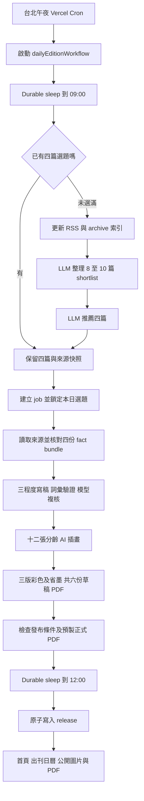
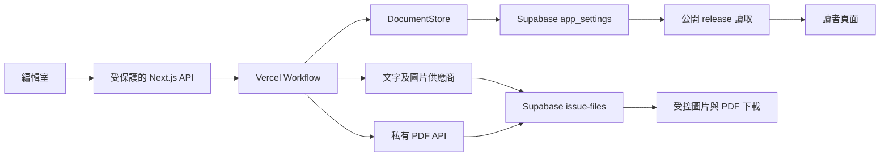

# Daily Digest 流程與系統架構

更新日期：2026 年 11 月 21 日。本文描述目前本機程式的主線；下一步與雲端待核對事項在 [TODO](TODO.md)。

產品是一份每日四個故事、三種英文程度的新聞報紙。編輯者透過網頁選題，Vercel 後端取得來源、生成及複核文字、產生 AI 插畫與 PDF，最後把公開版本存到 Supabase。讀者不需要編輯室密碼或模型金鑰。

## 技術與執行位置

| 元件 | 實作與用途 |
| --- | --- |
| 網頁與 API | Next.js 16、React 19、TypeScript，App Router |
| 背景工作 | Vercel Workflow，支援 durable sleep 和逐步續跑 |
| 發動排程 | Vercel Cron；UTC 16:00 相當於台北次日 00:00 |
| 狀態與發布資料 | Supabase `app_settings` JSON 文件，`dayday:web:v1:` namespace |
| 圖片與 PDF | Supabase 私有 bucket `issue-files` |
| 文字模型 | 目前 web adapter 為 NVIDIA 相容 Chat Completions，Zod 驗證 |
| 生圖模型 | 正式新聞目前主要用 NVIDIA FLUX.2-Klein；支援可設定順位機制 |
| 圖片處理 | Sharp，產出 WebP／印刷 JPEG，試樣可裁圖及純黑白化 |
| PDF | Playwright Core、Sparticuz Chromium、內嵌字體及 CSS 模板 |
| 原始碼與部署 | GitHub → Vercel；日常生成不需推送 Git 或 GitHub Actions |

Node 版本為 24，pnpm 為 `11.25.0`；依賴以 `package.json` 及 `pnpm-lock.yaml` 為準。家長會員及舊 SQL pipeline 仍在程式樹，但不是目前公開新聞主線。

## 每日流程

午夜 Cron 是提前建立可持續等待的工作，不是在午夜出刊，也不依賴使用者開著網頁。09:00／12:00 由設定資料決定；來源抓取及模型呼叫需要時間，因此選題 job 的建立時間可以晚於 09:00。

手動選題從 `/editor` 呼叫同一套 news API。手動按生成會啟動 `generateEditionWorkflow`，完成後停在審閱；使用者勾選確認並按「審核通過並發布」。日常 workflow 則在自動門檻通過後等到設定時間放行。

## 入口與檔案位置

| 路徑或檔案 | 職責 |
| --- | --- |
| `components/NewsDesk.tsx` | 來源／題材勾選、shortlist、四篇選擇與排程設定 |
| `components/WebJobReview.tsx` | 稿件、用量、log、PDF、審核與發布按鈕 |
| `app/api/editorial/news/route.ts` | inspect、settings、refresh、select、generate、schedule |
| `app/api/editorial/jobs/` | 工作讀取、分步推進、重試、手動發布 |
| `app/api/cron/daily/route.ts` | 驗證 `CRON_SECRET` 後啟動當日日常流程 |
| `lib/editorial/background.ts` | 啟動 Workflow 與 hook 去重；日常恢復有獨立 attempt |
| `workflows/edition.ts` | 單期、每日、七期歷史補跑的 durable orchestration |
| `workflows/steps.ts` | 資料讀取、生成推進、發布檢查、正式 PDF 及 release 步驟 |
| `lib/editorial/news-config.ts` | 來源 pool、六個題材、設定 schema、日期與時間 |
| `lib/editorial/news.ts`、`news-archive.ts` | RSS／歷史索引、選題、讀文、引文與事實抽取 |
| `lib/editorial/web-jobs.ts` | Job 建立、lease、checkpoint、圖稿狀態與發布 gate |
| `lib/pipeline/editorial.ts` | 現行三程度逐版寫稿、詞彙修補及模型複核 |
| `lib/providers/text.ts`、`image.ts` | 供應商請求、回覆驗證與錯誤分類 |
| `lib/editorial/web-images.ts` | 圖像請求紀錄、順位、檔案轉換、儲存與 receipt |
| `lib/pdf/` | PDF 私有分派、瀏覽器序列化、暫存 profile 及輸出 |
| `lib/editorial/web-public.ts`、`lib/db/issues.ts` | 公開讀取、期刊清單、雲端與 bundled catalog 的選擇 |
| `app/api/editorial/setup/route.ts` | 受保護的維護、診斷與特定恢復動作 |

## 新聞來源與事實資料

目前預設 pool 包括 BBC、The Guardian 多個版面、Smithsonian 及 Global Voices；NASA 可選，預設不勾選。來源清單在 `news-config.ts`，不是在 PDF 模板或 GitHub runner 裡設定。

RSS 是發現新聞的索引。選中故事後才讀網頁，暫時抽取正文作事實核對；不把新聞全文當作長期文章鏡像。事實資料保留 source URL、原刊登時間、讀取時間、必要證據摘錄、claim ID 與必留核心事實。

網頁經允許網域、robots、大小與逾時限制處理。事實引文必須對應原文連續段落；僅容許字型標點、NFKC 及空白等正規化，不做模糊猜測。事件日期需有完整原文證據，否則保持 `null`；來源刊登時間、事件日期與實際發布時間是不同欄位。

自動選題時，來源失效或敏感故事可換成 shortlist 的其他候選。原候選、已通過事實及成功模型回覆須保留，避免來源重新排名後破壞 checkpoint。跨日去重目前以已發布 URL 為主；歷史失敗後補發曾產生一篇來源跨兩日重複，須在結果中如實記錄。

## Job 與資料儲存

`web-store.ts` 以文件版本做 compare-and-swap。`changeDocument` 重試版本衝突；不是讀出後無條件覆蓋。Job 的 lease 防止兩個 worker 同時推進，`activeStep` 標記尚未確定完成的模型請求。

重要文件鍵都加上 `dayday:web:v1:`：

| 鍵 | 用途 |
| --- | --- |
| `news:settings` | 來源、題材、時間及編輯方向 |
| `news:round:<id>` | Shortlist、候選快照、推薦與 selector 回覆診斷 |
| `news:plan:<date>` | 當日選題、job、鎖定、run ID 及恢復次序 |
| `job:<id>` | 稿件、facts、checkpoint、圖像狀態、PDF、用量及事件 |
| `release:<date>` | 讀者可見版本、發布方式、實際發布時間與 PDF manifest |
| `workflow:job:<id>` | 單期工作與 run ID 的關聯 |
| `asset:<sha>`、`image-result:<hash>` | 圖像中繼資料與防止重複生圖的成功 receipt |
| `image-attempt:<hash>` | 每次 prompt、模型、狀態、錯誤與時間 |
| `usage:<date>`、`usage:backfill:<id>` | 文字請求與 token／費用預留 |
| `image-budget:<scope>` | 生圖嘗試次數，含失敗及備援 |
| `pdf:render:<hash>` | 每份 PDF 的成功 checkpoint |
| `publication-plan:<job>:<fingerprint>` | 正式輸出目錄與時間，重試時不重新取新目錄 |
| `backfill:<id>` | 七期日期、job、report、預算與 run |
| `image-study:<id>`、`image-budget-review:<id>` | 試樣與明確管理調額的紀錄 |

圖片放在私有 bucket 的 `web-assets/`，PDF 在 `web-editorial/<job>/`，正式檔案另有 `published-<uuid>/` 目錄。資料庫文件只放 metadata／路徑，沒有把大圖 base64 塞進 job。

主要狀態：`pending` → `running` → `needs_review`，或在無法完成時進入 `needs_attention`。正式發布是獨立的 release，不是單純把 job 狀態文字改成 published。

## 現行文字生成與未來批次方向

現行 `produceEditions` 先跑國小，再跑國中、高中；每版逐題寫稿、檢查必留事實及詞彙，再交模型複核。每題後續程度知道前面程度用過的詞彙，確保同題三版合計六詞不重複。

四題基本為十二次寫稿、十二次複核，另有四次來源事實核對。詞彙修補、真正的內容修訂及限流嘗試另計。正文通過而單字有問題時，盡可能只修詞彙，不重寫全文；`glossary-repair.ts` 接受正文確實存在的片語，不再只允許單字 enum。

成功步驟以輸入／輸出雜湊快取，writer／reviewer prompt 也保存在 job。CRLF／LF 恢復必須符合原雜湊；不能為了續跑任意換 hash 或重置付費步驟。

提議中的下一版是「每題一次三版寫稿，再一次三版複核」。它尚未接入正式流程。一次回覆要拆成可獨立驗證與補修的三版；同一 API usage 只記一次。新契約不能冒用舊 checkpoint，已完成稿件也不應因新架構而重做。

## 圖像生成與拼圖試樣

正式新聞目前逐題、逐程度生圖。`web-images.ts` 先檢查成功 receipt，再預留請求次數、呼叫模型、驗證 raster、轉成 web／print 兩份、上傳，最後保存資產與 receipt。

`image-config.ts` 讀取 `NVIDIA_IMAGE_MODEL_PRIORITY` 或單一 `NVIDIA_IMAGE_MODEL`。`image-priority.ts` 最多按三個設定依序嘗試；明確內容過濾、逾時及適當的服務錯誤可換下一個，認證和預算問題停止。每次請求都占用次數，不會因被拒而抹除。

順位機制存在不代表三家平台已串接。實際新模型名單還等使用者測試；支援清單也不等於當下端點仍可用，舊 adapter 不應直接當作已通過的正式備援。

這個 NIM 部署實際回覆 `prompt` 最多 800 字元，因此正式 prompt 已精簡，保留完整核心句及年齡風格，不截斷事實句。`CONTENT_FILTERED`、800 字元造成的 `HTTP 422`、逾時和 `HTTP 429` 必須分開記錄。

`illustration-sheet.ts` 與 `image-study.ts` 可一次請求拼圖，再裁出國小、國中、高中與成人黑白試樣。**相近或相同風格不是重生理由**；本機已移除重複圖樣拒絕條件，僅保留必要檔案、尺寸、空白及裁切檢查。現有回圖保留，不為追求四種明顯風格再花請求。成人仍是試樣，正式 `edition` 只有三個學生程度。

## PDF 與發布

`dispatchWebPdfs` 以永久 `CRON_SECRET` 呼叫 `/api/internal/pdf`，不把管理員 token 當作日常 PDF 憑證。私有 API 檢查 job fingerprint；正式輸出還要通過發布 gate。

PDF 模板在 `lib/render.mjs`、`app/globals.css`、`lib/pdf/options.mjs`。字體與 Chromium／Playwright metadata 必須經 `next.config.ts` 的 tracing 帶入函式。每次瀏覽器使用獨立暫存 profile，同程序的 PDF 工作會序列化，避免多個瀏覽器重疊。

瀏覽器關閉與版面溢出是不同原因。`checkPrintLayout` 檢查四篇、圖片存在、標題／圖／正文順序、overflow 及最低字級；底部頁尾含實際頁碼，紙色鋪到底。不要把 `PDF_LAYOUT_FAILED` 的外層名稱當作一定是 CSS 問題，要看內層 log。

草稿及正式 PDF 都保存個別成功 receipt。正式 `publicationPlan` 固定輸出目錄、時間和來源 fingerprint；若第三份上傳失敗，重試可沿用前面檔案，無需再呼叫文字或生圖模型。

自動發布要求三版四篇、十二份有效複核、每題六個不同有效詞彙、十二張 AI 插畫及六份可驗證 PDF，並檢查來源敏感度。人工發布另需管理者確認和一致的 fingerprint。`publishScheduledJob`／`publishWebJob` 透過版本檢查寫入 release，再 revalidate 讀者頁面。資料庫保存的雲端 release 與 repo 內 bundled catalog 並存；`lib/db/issues.ts` 依閱讀模式與日期選擇，不能把 bundled 樣刊當作這次 live 生成的證據。

## 錯誤恢復與成本

| 情況 | 處理 |
| --- | --- |
| HTTP 429 | 記為 declined、保留預留，durable 等待 Retry-After；未提供則 60 秒，同一步驟連續超過三次停止 |
| 網路逾時／缺用量／未知結果 | 保持 unknown，停止，不能假設免費或直接抹除重跑 |
| 舊 unknown 已有明確續作決定 | 受保護管理動作留理由與 actor；原 calls、token 預留和保守費用仍保留；新 unknown 仍會再停 |
| 模型 JSON／詞彙格式問題 | 保存原回覆；可驗證恢復原付費回覆時優先恢復，只補失敗部分 |
| 圖像上傳或儲存狀態重試 | 先找成功 receipt，避免重新叫模型 |
| 生圖次數到限 | 停止且不放行缺圖刊物；只有明確管理調額可增加，必須留下原／新上限與理由 |
| PDF 失敗 | 重用稿件、圖片與已完成 PDF，查看原始錯誤後續跑 |

手動續跑每日工作用 `resume-daily` 保留選題與 job；`reopen-selection` 會解除舊選題階段，不能把它當一般恢復工具。

## 憑證與資料邊界

`web-store.ts` 優先配對 `DAILY_DIGEST_SUPABASE_URL` 與 `DAILY_DIGEST_SUPABASE_SECRET_KEY`；再處理其他 Marketplace 或 legacy 設定。不要把新專案 URL 與舊專案金鑰混用。Opaque `sb_secret_` 使用 `apikey`，不是 JWT bearer。

`EDITOR_ACTION_SECRET` 用於管理員解鎖，`EDITOR_SETUP_TOKEN` 是有到期限制的暫時維護權限，`CRON_SECRET` 是日常 workflow／私有 PDF 溝通的永久憑證。這些都只存在服務端設定或忽略的本機檔案；公開頁面不應取得它們。

## 接手與驗證資料

- [開發待辦](TODO.md) 列出目前未完成工作、識別碼與操作順序。
- [原模板](reference/DD_2026-11-17_junior_r1_color.pdf) 是使用者提供的版面參考；圖片位置採使用者後續指定的滿欄版本。
- `output/news-workflow/verification.json` 為合成外部服務的完整流程證據。
- `output/backfill/verification-<date>.json` 及 `-pdfs.json` 為實際公開下載與 PDF 檢查證據；未完成的 18 日不能算入成功。
- `.runtime/latest-task-state.json` 保留這個 workspace 的詳細接手快照，不含實際金鑰。
- `output/handoff/source-verification.json` 列出本機檔案 SHA、缺漏檢查和 Git 狀態；`DailyDigest-source-2026-11-21.zip` 保留完整應用程式工作樹與白名單輔助工具，不包含雲端資料或金鑰。
